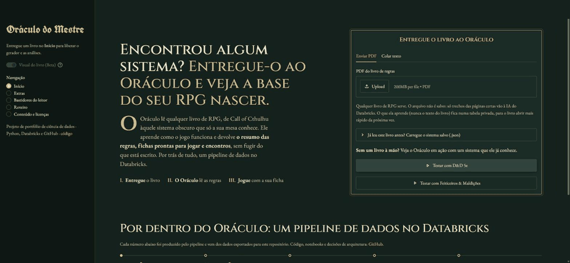
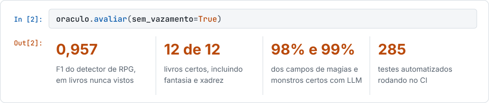
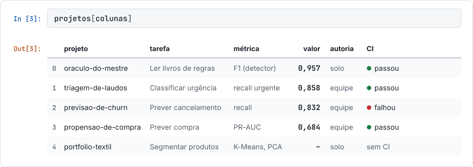

<picture>
  <source media="(prefers-color-scheme: dark)" srcset="assets/hero-escuro.svg?v=2">
  <source media="(prefers-color-scheme: light)" srcset="assets/hero-claro.svg?v=2">
  
</picture>

Comecei na programação e hoje foco em **ciência de dados**. Gosto de projetos que saem do notebook: modelos avaliados sem vazamento, testes, CI e deploy.

[LinkedIn](https://www.linkedin.com/in/pedro-henrique-ostroski/) · [Site do Oráculo do Mestre](https://oraculo-do-mestre.streamlit.app/)

<b>Read in English</b>

 

I started in programming and now focus on **data science**. I hold an MBA in Data Science and Analytics from USP/Esalq and I'm taking a postgraduate program in Machine Learning Engineering at FIAP (Brazil). I like projects that make it out of the notebook: leakage-free evaluation, tests, CI and deployment.

**Featured project: [Oráculo do Mestre](https://github.com/Plee47/oraculo-do-mestre)** ([live site](https://oraculo-do-mestre.streamlit.app/), in Portuguese) reads any tabletop RPG rulebook and returns a system summary, valid character sheets and encounter analysis, explaining where each number came from. It combines a medallion pipeline on Databricks, a classifier evaluated with leave-one-book-out (F1 0.957), and LLMs benchmarked against a ground truth.

| Project | Task | Key metric | Authorship |
|---|---|---|---|
| [Medical report triage](https://github.com/Plee47/TC3-Triagem-de-Laudos-Medicos-com-FastAPI-Docker-Airflow-Prometheus-Grafana-e-ONNX) | Text classification by urgency | Urgent recall 0.858 | Team (my part: architecture decision and initial Docker API) |
| [Churn prediction](https://github.com/Plee47/TC1-Rede-Neural-para-Previsao-de-Churn-com-Pipeline-Profissional-End-to-End) | Telecom churn with PyTorch | Recall 0.832 | Team |
| [Purchase propensity](https://github.com/Plee47/TC2-Pipeline-de-ML-para-Propensao-de-Compra-com-Docker-DVC-e-MLflow) | E-commerce sessions | PR-AUC 0.684 | Team |
| [Textile portfolio clustering](https://github.com/Plee47/OtimizacaoDePortfolioPorClusterizacaoNaoSupervisionada) | Product segmentation | K-Means, PCA | Solo |

## Projeto em destaque: Oráculo do Mestre

Lê qualquer livro de regras de RPG e entrega o resumo do sistema, fichas válidas e análises de encontro, explicando de onde veio cada número.

<picture>
  <source media="(prefers-color-scheme: dark)" srcset="assets/oraculo-escuro.svg">
  <source media="(prefers-color-scheme: light)" srcset="assets/oraculo-claro.svg">
  
</picture>

- **Machine learning:** classificador avaliado com *leave-one-book-out*, registrado no MLflow e promovido por um portão de qualidade.
- **LLMs com gabarito:** três modelos comparados campo a campo. A saída do escolhido é validada antes de ser usada.
- **Engenharia de dados:** pipeline medalhão em Delta no Databricks, com expectativas de qualidade que derrubam o job se o catálogo vier errado.

**[Abrir o site](https://oraculo-do-mestre.streamlit.app/)** · **[Ver o código](https://github.com/Plee47/oraculo-do-mestre)**

## Projetos

<picture>
  <source media="(prefers-color-scheme: dark)" srcset="assets/placar-escuro.svg">
  <source media="(prefers-color-scheme: light)" srcset="assets/placar-claro.svg">
  
</picture>

- **[Oráculo do Mestre](https://github.com/Plee47/oraculo-do-mestre):** F1 de 0,957 no detector de livros.
- **[Triagem de laudos médicos](https://github.com/Plee47/TC3-Triagem-de-Laudos-Medicos-com-FastAPI-Docker-Airflow-Prometheus-Grafana-e-ONNX):** recall de 0,858 em "urgente". Em equipe; minha parte foi a decisão arquitetural e a API inicial em Docker.
- **[Previsão de churn](https://github.com/Plee47/TC1-Rede-Neural-para-Previsao-de-Churn-com-Pipeline-Profissional-End-to-End):** rede neural em PyTorch com recall de 0,832, modelo escolhido pelo custo do erro. Em equipe.
- **[Propensão de compra](https://github.com/Plee47/TC2-Pipeline-de-ML-para-Propensao-de-Compra-com-Docker-DVC-e-MLflow):** PR-AUC de 0,684, 4,4x acima da linha de base. Em equipe.
- **[Portfólio têxtil](https://github.com/Plee47/OtimizacaoDePortfolioPorClusterizacaoNaoSupervisionada):** segmentação de malhas sintéticas com K-Means, Elbow, Silhouette e PCA.

Status do CI atualizado automaticamente pelo GitHub Actions.
